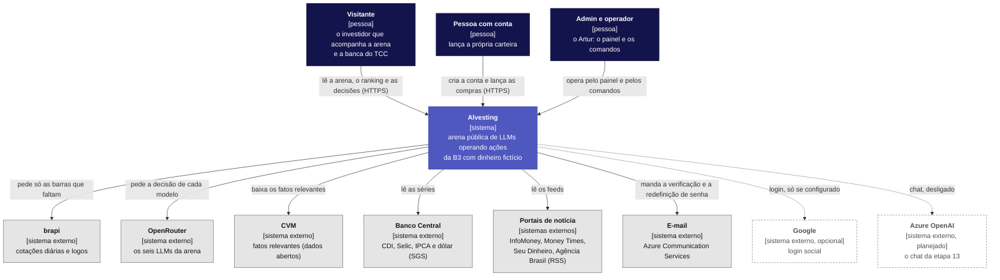
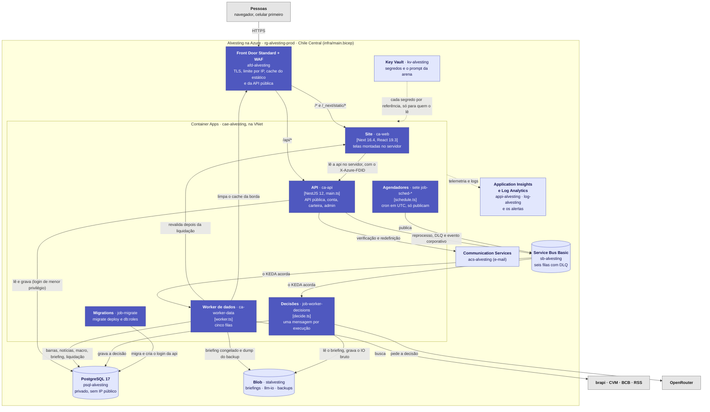
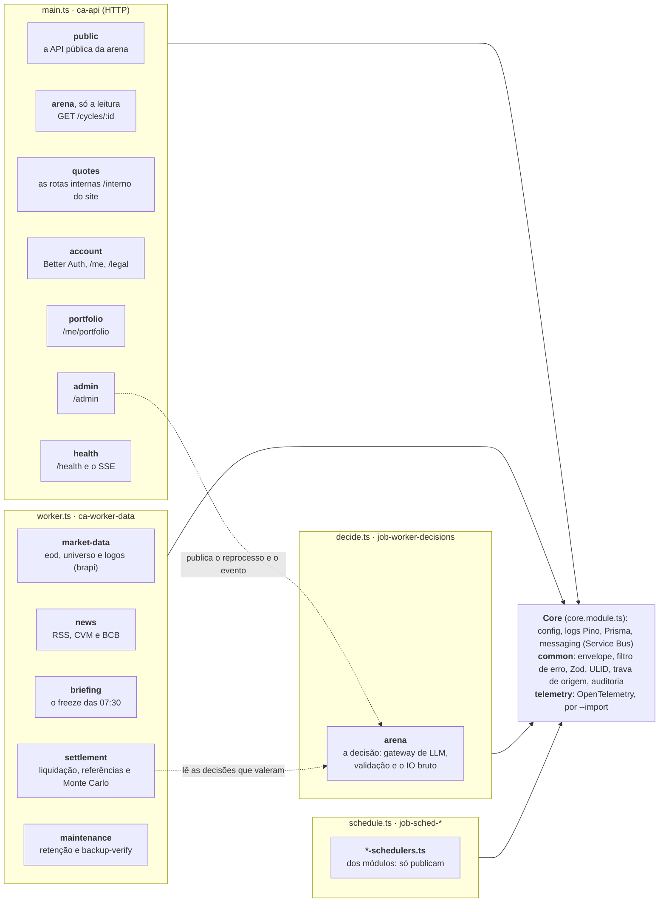
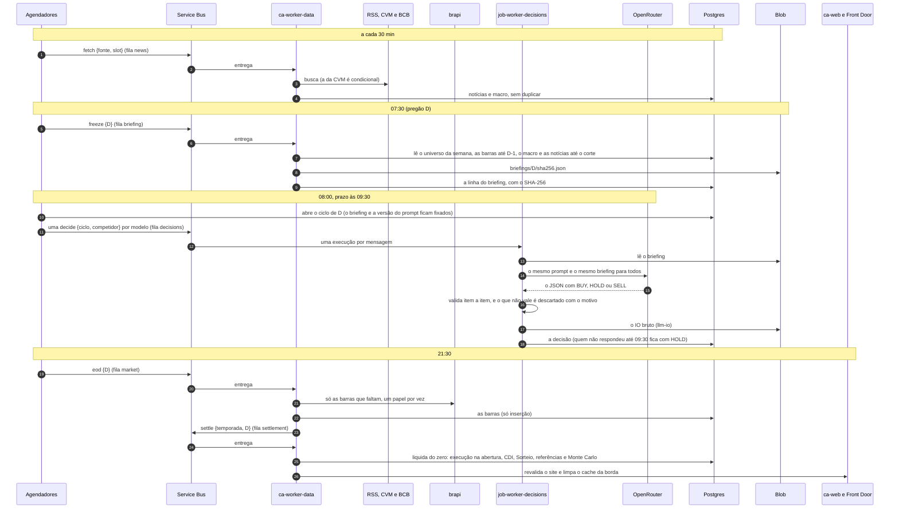
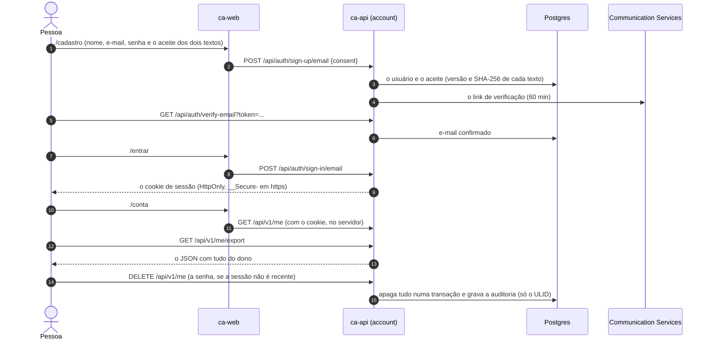
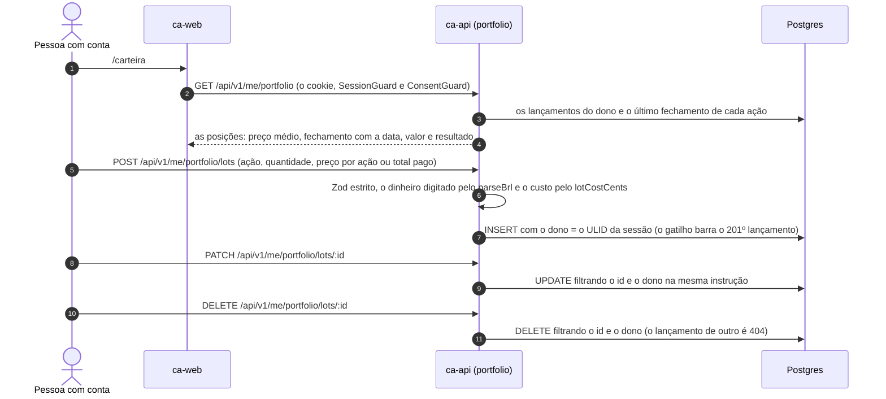
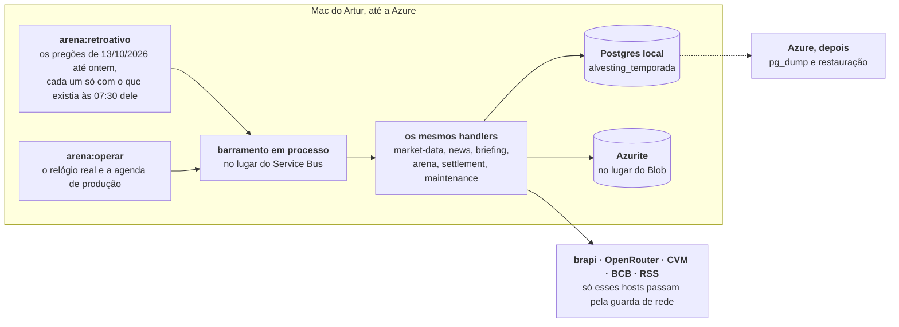

# Arquitetura (modelo C4)

A arquitetura da Alvesting nos três primeiros níveis do modelo C4 (contexto, contêineres e componentes), mais o desenho em sequência dos
três fluxos de negócio completos das [user stories](USER-STORIES.md). É o "diagrama de arquitetura" que a linha Web Apps do Playbook da
Católica SC pede. Os detalhes de cada peça estão nos documentos de cada uma: [INFRA.md](INFRA.md) (o que o Bicep cria),
[JOBS.md](JOBS.md) (agendadores, filas e workers), [API.md](API.md), [TELAS.md](TELAS.md) e [CONTA.md](CONTA.md); as decisões, nos
[ADRs](adr/).

**Como os diagramas foram desenhados.** Em Mermaid, que o GitHub e a Wiki desenham a partir do texto, com as convenções do C4: pessoa,
sistema, contêiner, componente, e cada seta com o verbo do que passa por ela. Usei o `flowchart` do Mermaid, e não o tipo `C4Context`, que
a documentação do Mermaid ainda marca como experimental e que embaralha diagramas com muitas caixas. **Cada caixa existe no Bicep e no
código:** a tabela de cada nível diz o arquivo.

**Estado (06/11/2026).** Tudo o que está aqui existe no código e foi testado sem a Azure (com os fakes, o Postgres e o Azurite locais e o
emulador do Service Bus). **Nada foi implantado**: o primeiro deploy depende do repositório público e da assinatura de estudante
([DEPLOY.md](DEPLOY.md), "Como implantar"). Até lá, o pipeline da Temporada 1 roda num Mac (seção 5), e essa parte **está em construção**.

---

## 1. Nível 1: contexto

Quem usa a Alvesting e com quais sistemas de fora ela fala.

| Caixa | Onde está no código |
|---|---|
| brapi | `apps/api/src/modules/market-data/infrastructure/brapi.client.ts` (a única porta para a brapi; ADR 0032) |
| OpenRouter | `apps/api/src/modules/arena/infrastructure/llm-gateway.ts` (`OPENROUTER_BASE_URL`) |
| CVM e Banco Central | `apps/api/src/modules/news/domain/cvm.ts` (`CVM_HOST`) e `bcb.ts` (`BCB_HOST`), lidos por `apps/api/src/modules/news/application/cvm-fetcher.ts` e `bcb-fetcher.ts` |
| Portais de notícia | `apps/api/src/modules/news/domain/sources.ts` (a lista fixa de feeds), lidos por `apps/api/src/modules/news/application/rss-fetcher.ts` |
| E-mail | `apps/api/src/modules/account/infrastructure/email/` (em dev e teste, um remetente falso que grava numa pasta) e `infra/modules/email.bicep` |
| Google (opcional) | `apps/api/src/modules/account/infrastructure/auth.ts` (só com `GOOGLE_CLIENT_ID` e `GOOGLE_CLIENT_SECRET`) |
| Azure OpenAI (planejado) | `infra/modules/openai.bicep` (só com `enableOpenAI`); o chat não existe: a tela `/chat` está desligada (`apps/web/src/app/(app)/(chat)/chat/page.tsx`) |

---

## 2. Nível 2: contêineres

O que roda, e onde, no perfil padrão da Azure (`infra/main.prod.bicepparam`, `profile = 'padrao'`). O perfil econômico tira o Front Door e o
ACR e põe cada app no próprio endereço ([INFRA.md](INFRA.md), 1.3).

| Contêiner | No Bicep | No código |
|---|---|---|
| Front Door Standard + WAF | `infra/modules/frontdoor.bicep` (o perfil, os endpoints `alvesting` e `alvesting-green`, as rotas e o WAF) | a trava de origem: `apps/api/src/common/origin-lock.ts` e `apps/web/src/proxy.ts` (só atendem quem traz o `X-Azure-FDID` do perfil; ADR 0018) |
| Site (`ca-web`) | `infra/modules/containerapps.bicep` (`ca-web`) | `apps/web/` (imagem `apps/web/Dockerfile`; a leitura da api em `apps/web/src/lib/api.ts`) |
| API (`ca-api`) | `containerapps.bicep` (`ca-api`) | `apps/api/src/main.ts` e `app.module.ts` |
| Worker de dados (`ca-worker-data`) | `containerapps.bicep` (`ca-worker-data`, escala pela fila) | `apps/api/src/worker.ts`; as filas e os handlers em `apps/api/src/role.ts` (`queueHandlers`) |
| Decisões (`job-worker-decisions`) | `containerapps.bicep` (`job-worker-decisions`, por evento) | `apps/api/src/decide.ts` |
| Agendadores (`job-sched-news`, `-briefing`, `-cycle`, `-eod`, `-universe`, `-retention`, `-backup`) | `containerapps.bicep` (a lista `schedulers`, com o cron de cada um) | `apps/api/src/schedule.ts`; a tabela em `apps/api/src/role.ts` (`schedulers`) |
| Migrations (`job-migrate`) | `containerapps.bicep` (`job-migrate`, manual) | `apps/api/prisma/migrations/` e `apps/api/src/db-roles-cli.ts` |
| Service Bus Basic | `infra/modules/servicebus.bicep` (as filas `market`, `news`, `briefing`, `decisions`, `settlement` e `maintenance`) | `apps/api/src/modules/messaging/` (ADR 0004, 0005 e 0015) |
| PostgreSQL 17 | `infra/modules/postgres.bicep` | `apps/api/prisma/schema.prisma` e `apps/api/src/infrastructure/database/` (o papel mínimo da api: `table-policy.ts`, ADR 0028) |
| Blob | `infra/modules/storage.bicep` (os containers `briefings`, `llm-io` e `backups`, cada um com o acesso só de quem o usa: ADR 0030) | `apps/api/src/infrastructure/storage/blob-client.ts`; `modules/briefing/infrastructure/briefing.archive.ts`, `modules/arena/infrastructure/llm-io.archive.ts` e `modules/maintenance/application/backup-verify.handler.ts` |
| Key Vault | `infra/modules/keyvault.bicep` e `secret-access.bicep` (um papel por par workload e segredo; ADR 0020) | os segredos chegam como variáveis de ambiente por referência ao cofre, lidas e validadas em `apps/api/src/config/env.ts` |
| Application Insights, Log Analytics e alertas | `infra/modules/observability.bicep` e `alerts.bicep` | `apps/api/src/telemetry/` (o que sai é lista branca: `sanitize.ts`) e `telemetry/alert-logs.ts`; o runbook de cada alerta em [RUNBOOK.md](RUNBOOK.md) |
| Communication Services (e-mail) | `infra/modules/email.bicep` | `apps/api/src/modules/account/infrastructure/email/` |

Fora do desenho, para ele caber: o ACR das imagens (`infra/modules/acr.bicep`, publicado pelo `deploy.yml`), as identidades de cada
workload (`identity.bicep`), a rede (`network.bicep`), o ambiente do Container Apps (`containerenv.bicep`), o orçamento (`budget.bicep`) e o
Azure OpenAI opcional (`openai.bicep`).

**A mesma imagem em quatro papéis.** A api, o worker, as decisões e os agendadores são uma imagem só (`apps/api/Dockerfile`); quem escolhe o
papel é o comando do contêiner (`node dist/main.js`, `worker.js`, `decide.js`, `schedule.js <nome>`). Cada papel carrega só os módulos dele
(`apps/api/src/app.module.ts` e `roles.module.ts`), e cada um tem a própria identidade: só as decisões leem o prompt e a chave do
OpenRouter, e só o worker tem o token da brapi ([INFRA.md](INFRA.md), 3.2).

---

## 3. Nível 3: componentes da api

Os módulos do NestJS dentro da imagem da api, agrupados pelo papel que os carrega. Cada módulo tem as camadas `application` (casos de uso e
handlers), `domain` (regras puras, sem banco nem rede), `infrastructure` (Prisma, Blob, clientes HTTP) e `presentation` (controllers e
guards), a convenção do `CLAUDE.md`.

| Componente | Onde está | O que faz |
|---|---|---|
| `public` | `apps/api/src/modules/public/` | As rotas `GET` da arena, com cache e schema estrito na saída (`docs/API.md`, seção 1) |
| `arena` | `apps/api/src/modules/arena/` | Temporada e elenco, o ciclo das 08:00, a decisão de cada modelo (`modules/arena/application/decide.handler.ts`, `modules/arena/infrastructure/llm-gateway.ts`, `modules/arena/domain/decision-validation.ts`) e a leitura do ciclo (`modules/arena/presentation/cycles.controller.ts`) |
| `quotes` | `apps/api/src/modules/quotes/` | As barras, a fita e os logos para o servidor do site, só com o segredo dele (ADR 0033) |
| `account` | `apps/api/src/modules/account/` | Login (Better Auth), sessão, aceite versionado, exportar e excluir, papéis e os guards |
| `portfolio` | `apps/api/src/modules/portfolio/` | A carteira do usuário (ADR 0031) |
| `admin` | `apps/api/src/modules/admin/` | As rotas do painel, com a trilha de auditoria (ADR 0027) |
| `market-data` | `apps/api/src/modules/market-data/` | O calendário de pregões, o universo, as barras e os logos da brapi |
| `news` | `apps/api/src/modules/news/` | As notícias, os fatos relevantes e o macro |
| `briefing` | `apps/api/src/modules/briefing/` | A entrada comum congelada, com o SHA-256 |
| `settlement` | `apps/api/src/modules/settlement/` | A liquidação do zero, o CDI, o Sorteio, as referências, o Monte Carlo, o evento corporativo e a revalidação depois (ADR 0022) |
| `maintenance` | `apps/api/src/modules/maintenance/` | A retenção diária e o backup-verify mensal |
| `messaging` | `apps/api/src/modules/messaging/` | O cliente do Service Bus, a nova tentativa agendada e a DLQ (ADR 0015 e 0021) |
| `health` | `apps/api/src/infrastructure/health/` | O `/health` das sondas e o SSE de teste (ADR 0017) |

**O site** (`apps/web/src/`) não tem estado próprio: as telas são componentes de servidor que leem a api (`lib/api.ts`, com o cache de dados do
Next revalidado depois de cada liquidação), as cotações vêm das rotas internas (`lib/quotes.ts`, `import 'server-only'`), e a trava de
origem e o redirecionamento antigo ficam em `proxy.ts`. Os formulários (conta, carteira, painel) são componentes de cliente que chamam a
api direto, na mesma origem.

---

## 4. Os três fluxos de negócio, em sequência

### 4.1 O ciclo diário da arena

Os horários são de Brasília; o cron dos agendadores está em UTC no `infra/modules/containerapps.bicep` ([JOBS.md](JOBS.md), seção 1).

### 4.2 A conta, com a LGPD

Tudo passa pelo Front Door, numa origem só (o site em `/*` e a api em `/api/*`; ADR 0025). Em dev e no e2e, o e-mail cai numa pasta.

### 4.3 A carteira

---

## 5. A variante de hoje: o operador local no Mac (em construção)

Até a Azure existir, a Temporada 1 roda num Mac, com os serviços reais e o mesmo motor da Azure. **Em construção pela tarefa T0 da onda de
06/11/2026**; esta seção descreve o que ela vai entregar, e o relatório dela fica em `docs/temporada-1/relatorios/t0-temporada-real.md`.

- **O que já existe e é reaproveitado:** o ensaio da Temporada 0 (`apps/api/src/ensaio/`): `world.ts` liga os handlers de verdade a um
  barramento em processo (`bus.ts`, com a paridade contra o Service Bus testada em `bus-parity.spec.ts`), e `driver.ts` monta a linha do
  tempo com os agendadores de produção (`runScheduler`, em `role.ts`). O retroativo e o operador são esse motor com as peças reais no lugar
  dos fakes.
- **O que muda para quem lê o resultado:** cada ciclo grava o modo (`RETROATIVO` ou `AO_VIVO`) e a hora real em que rodou; o site marca os
  pregões retroativos. Pregão com o Mac desligado não vira "ao vivo" atrasado: fica para o retroativo. As regras de visibilidade de cada
  fonte e a honestidade do trecho retroativo ficam no `docs/METODOLOGIA.md` e no `docs/DADOS.md`.
- **O que não existe nesta variante:** o site público, o Front Door, os alertas e a telemetria na Azure. O banco da temporada vai para a
  Azure depois, pelo `pg_dump` e a restauração do [RUNBOOK.md](RUNBOOK.md).

---

## 6. As decisões que dão a forma

| Decisão | ADR |
|---|---|
| O agendador só publica; o trabalho é dos workers, que escalam pela fila | [0007](adr/0007-agendador-so-publica.md), [0006](adr/0006-dois-workers-nao-um-por-fila.md) |
| Service Bus (e não Storage Queue nem BullMQ), no plano Basic | [0004](adr/0004-service-bus-nao-storage-queue-nem-bullmq.md), [0005](adr/0005-service-bus-basic-nao-standard.md) |
| Container Apps (e não AKS), Front Door Standard (e não Application Gateway nem Premium), Bicep (e não Terraform) | [0008](adr/0008-container-apps-nao-aks.md), [0002](adr/0002-front-door-standard-nao-application-gateway.md), [0003](adr/0003-front-door-standard-nao-premium.md), [0012](adr/0012-bicep-nao-terraform.md) |
| Decidir antes da abertura e executar no preço de abertura | [0010](adr/0010-decidir-antes-executar-na-abertura.md) |
| Nova tentativa agendada e a decisão que esgota vira HOLD | [0015](adr/0015-nova-tentativa-agendada-nao-abandono-imediato.md), [0021](adr/0021-dlq-vira-hold-pelo-handler-na-ultima-entrega.md) |
| Uma identidade por workload, segredo a segredo; o Blob por container e o Service Bus por fila | [0020](adr/0020-uma-identidade-por-workload-segredo-a-segredo.md), [0030](adr/0030-blob-por-container-service-bus-por-fila-e-sem-imutabilidade.md) |
| A trava de origem e a única exceção de saúde | [0018](adr/0018-trava-de-origem-health-unica-excecao.md) |
| O papel mínimo do Postgres da api e o backup sem dado pessoal | [0028](adr/0028-papel-minimo-do-postgres-da-api-e-backup-sem-dado-pessoal.md) |
| Blue/green com o label `green` e o endpoint green no Front Door | [0029](adr/0029-blue-green-com-label-green-e-endpoint-green-no-front-door.md) |
| A brapi como fonte única, com o banco como cache, e a API pública sem cotação bruta | [0032](adr/0032-brapi-fonte-unica-das-cotacoes-e-banco-como-cache.md), [0033](adr/0033-api-publica-sem-cotacao-bruta-e-rota-interna-para-o-site.md) |
